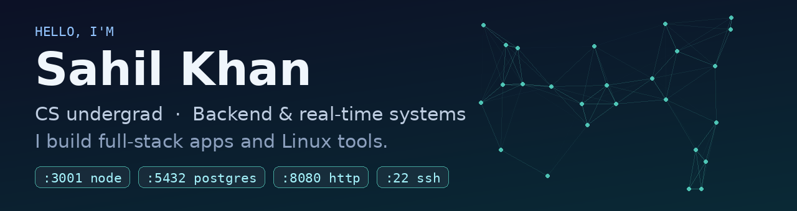

  

## 👋 About me

I'm a **Computer Science undergrad at Chandigarh University (2023 – 2027)** who likes building things that run close to the metal *and* things people actually use.

- 🔧 My home ground is the **backend** — Node.js, Express, WebSockets, real-time systems, REST APIs that stay up
- 🖥️ I also build **desktop tools for Linux** (GTK/Python) and full-stack apps with React + TypeScript
- 🎯 Currently grinding **DSA for internship season** and looking for **backend / full-stack SWE intern roles**
- 📄 Co-author on **SEVR**, a research paper on smart emergency-vehicle routing
- 🐧 Daily driver: a ThinkPad running Linux Mint, tuned more than it probably needed to be

## 🚀 Featured projects

| Project | What it is | Stack |
|---|---|---|
| **[PortMan](https://github.com/sahilimamk/portman)** | A clean GTK GUI to manage **every port on a Linux machine** — listening ports, live connections, UFW firewall rules, and USB/serial devices. Kill, block, or allow a port in one click. | Python · GTK3 · `ss` · UFW |
| **DSA Buddy** | An AI *peer* (not a tutor) for DSA interview prep — Socratic coaching, interviewer mode, and a browser observer that watches your runs/submits and learns from your mistakes. *In active development.* | React · Express · SQLite · WebSockets |
| **NetBond** | Bonds a laptop's Wi-Fi + USB-tethered phone into one smarter connection, with an adaptive proxy that learns which link is faster, per destination. | Python · nftables · Linux networking |
| **Stocky** | A paper-trading game with live NSE quotes — ₹1,00,000 virtual cash, portfolio P/L, trade history. Built to learn the Indian stock market without losing real money. | JavaScript · Live market data |
| **MiniLedger** | A loan-ledger app for tracking informal loans — OTP login, receipts with file-type verification, summaries, overdue tracking. | TypeScript · Node.js · PostgreSQL |
| **AI Army Dashboard** | A command center that puts multiple AI models to work like a team — a blind "council" mode where models answer the same question independently before I compare them. | Node.js · Multi-model APIs |

## 🛠️ Tech I work with

  

**Comfortable with:** REST APIs · WebSockets & real-time systems · SQL (joins, subqueries, aggregations) · JWT auth · Linux system tooling
**Currently levelling up:** Data structures & algorithms in depth · System design basics · LLM/AI integrations

## 📊 GitHub stats

  
  

  

## 🏆 Coding profiles

  
  

---

<i>Open to backend / full-stack internship opportunities — the best way to reach me is right here on GitHub.</i>

